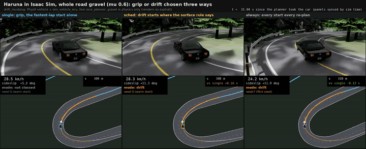
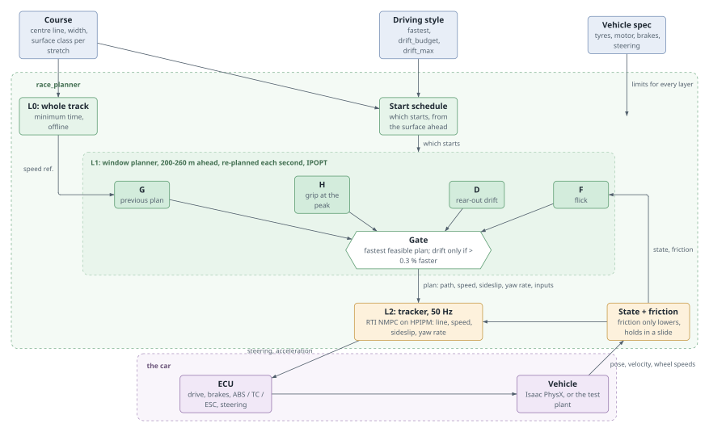
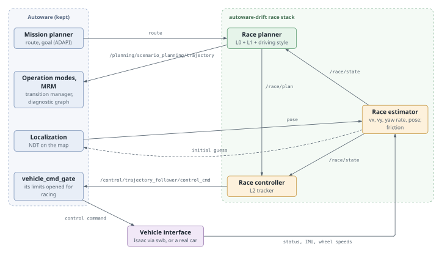

# autoware-drift

A racing stack for [Autoware](https://github.com/autowarefoundation/autoware): it plans and
drives the fastest way around a road for any car and surface, and chooses on its own where to
grip and where to drift. A minimum-time planner looks a few hundred metres ahead and re-plans
every second from where the car really is. A 50 Hz model-predictive tracker follows the
plan's line, sideslip and yaw rate. A driving-style layer above them sets the style: fastest
lap, drift where it costs little, or drift wherever it can.

It is not tied to one simulator, road or car:

- **Roads** come from a course description: centre line, width and a surface class per
  stretch. Asphalt, gravel, dirt, sand, mud, grass and snow are modelled; ice is a work in
  progress.
- **Cars** come from a vehicle spec (mass, tyres, motor, brakes, steering).
- **Driving it** today happens in NVIDIA Isaac Sim through
  [scenario-world-bridge](https://github.com/NEWSLabNTU/scenario-world-bridge) (swb). Its
  roadmap holds this project's phases (057, 058, 060, 061, 065).

<p align="center">
  
</p>
<p align="center"><sub>Haruna's hairpins in Isaac Sim, the whole road set to gravel (μ 0.6),
driven three ways at once: grip only, drift where the surface rule allows it, and a drift start
on every re-plan. The camera follows each car; below it, the plan ahead (orange where it
slides). All three finish the 1.43 km stretch within 1.5 s of each other.</sub></p>

## What it does

- **Plans while driving.** Each second, from the car's measured state, it solves a
  minimum-time problem over the next 200-260 m. Recovery is re-planning, not steering back to
  an old line.
- **Holds a slide on purpose.** The tracker follows the plan's sideslip and yaw rate as well
  as its path. A planned drift is driven, not merely tolerated.
- **Chooses grip or drift live.** Several starts are solved in parallel: the previous plan,
  grip held at the tyre's peak, a rear-out drift and a flick. A gate adopts drift only when it
  is measurably faster.
- **Knows the surface.** A map of surface classes sets friction and tyre fall-off, with a
  confidence for each zone. The car's own friction estimate can only lower the map's value,
  and holds through a slide.
- **Respects the car.** Every limit comes from the vehicle spec: power, motor torque, the
  brake split, regen, steering lock. No layer plans an input the car does not have.
- **Lets you pick the style.**

  | style | behaviour |
  |---|---|
  | `fastest` | the fastest lap; drifts only where drifting is the fastest way |
  | `drift_budget` | drifts wherever the lap loses at most ε |
  | `drift_max` | D1-style: drifts every place it can, straights included, keeping speed |

## Architecture

<p align="center"></p>

- **L0** solves the whole track once (minutes), as a speed reference.
- **L1** re-plans a window from the car's state within a one-second budget. It runs each
  start in its own process; the gate compares their lap-time estimates.
- **L2** tracks the adopted plan at 50 Hz. It predicts the car's slide with the same tyre
  model, so it can hold a drift that a path follower would fight.
- **The style layer** never adds a "drift bonus" to the cost. L1 always minimises time; a
  style decides which starts run, which constraints apply and what the gate may adopt.

Design:
[live planner](docs/superpowers/specs/2026-10-29-live-race-planner-design.md),
[offline planner](docs/superpowers/specs/2026-10-29-min-time-planner-design.md),
[driving styles](docs/superpowers/specs/2026-10-31-drift-style-layer-design.md),
[when drifting pays](docs/drift-optimality.md),
[how the grip-or-drift choice is made](docs/mode-choice-methods.md).
The diagrams are Typst sources in [docs/diagrams/](docs/diagrams/) (`typst compile --format svg`).

## How it fits into Autoware

Autoware keeps what a race needs from it (map, localization, routing, the operation modes,
the command gate, MRM and diagnostics) and hands over the two things it cannot do in a race:
the speed profile and the controller. The seams are Autoware's own topics, so nothing in
Autoware is forked.

<p align="center"></p>

- **Replaced:** scenario planning's output (the race planner publishes Autoware's trajectory
  topic) and the trajectory follower (`trajectory_follower_mode:=none`; the race controller
  publishes the follower's command topic).
- **Kept, set for racing:** the gate's limits are opened. Road-driving checks (lane departure,
  AEB, the trajectory-shift monitor) leave the diagnostic graph; the race nodes' own
  diagnostics take their place.

The design, and why each seam: [docs/race-stack-design.md](docs/race-stack-design.md). What a
drift does to stock Autoware: [docs/autoware-in-a-drift.md](docs/autoware-in-a-drift.md).

## Status

| piece | state |
|---|---|
| Offline minimum-time planner (L0) | built |
| Live planner and tracker (L1 + L2) | built; driven live in Isaac on Haruna's hairpins and Tsukuba, within 3.5 % of the whole-track plan, no contact |
| Grip-or-drift choice (multi-start, surface schedule, friction estimate) | built; being measured across surfaces. Asphalt, gravel, mud and snow test corners finish; ice partly (about 10 of 12) |
| Driving styles | `fastest` built; `drift_budget` in progress; `drift_max` designed |
| Race nodes on Autoware's seams (diagram above) | designed, not built. Today the live planner drives the car directly through swb's Isaac course runner, without Autoware in the loop |
| `drift_controller`: a drift law inside stock Autoware (the first approach) | built; a full Town05 ring lap with Autoware and a held drift. It showed why a race stack was needed |

Dated results, rulings and open issues: [docs/issues/](docs/issues/), the `docs/mode-choice-*.md`
reports, and swb's [roadmap](https://github.com/NEWSLabNTU/scenario-world-bridge/tree/main/docs/roadmap).

## Layout

| path | what |
|---|---|
| `src/planning/race_planner` | the planner and tracker (pure Python: CasADi, IPOPT, HPIPM). Key modules: `window.py` (L1's problem), `multistart.py` and `schedule.py` (starts and gate), `tracker.py` (L2), `live.py` (the driver loop), `surface.py` (surface map, friction estimate), `style.py` (driving styles), `serve.py` (a JSON-lines process a simulator drives), `sim.py` (the test plant). Studies in `studies/`, tests in `test/` |
| `src/control/drift_controller` | the first approach: a drift state machine (`law.py`) and a ROS node between Autoware's command gate and the vehicle |
| `src/launcher/drift_launch` | that approach's launch, Autoware parameter overrides (gate, smoother, diagnostic graph) and the Town05 ring scenario |
| `tools/` | proof videos (`lap_video.py` for Isaac runs, `arm_video.py` for side-by-side runs), lap analysis |
| `docs/` | designs, studies, issues |

The test car, `drift_mustang` (1450 kg, 50:50, a 330 kW rear motor, a locked rear axle,
58° of steering lock), is defined once in
[sim_vehicle_spec](https://github.com/NEWSLabNTU/sim_vehicle_spec). Its Autoware vehicle
packages and its Isaac rig are generated from that spec in swb.

## Try it

The planner runs without ROS or a simulator, against its own test plant:

```bash
cd src/planning/race_planner
uv venv && uv pip install -e '.[test]'      # or python3 -m venv .venv && .venv/bin/pip install -e '.[test]'

# one Haruna lap, dry, grip-or-drift chosen by the surface schedule
env -u PYTHONPATH .venv/bin/python studies/mode_choice_m4.py run haruna --arm sched
# the same road, all gravel, a drift start on every re-plan
env -u PYTHONPATH .venv/bin/python studies/mode_choice_m4.py run haruna@gravel --arm always
# one corner: class, radius m, turn deg, width m
env -u PYTHONPATH .venv/bin/python studies/mode_choice_m4.py run c:snow_packed:25:90:15 --arm sched

# tests
PYTEST_DISABLE_PLUGIN_AUTOLOAD=1 .venv/bin/python -m pytest -q test
```

`RP_DET=1` makes a run repeatable bit for bit: the solvers run without a clock. Add
`RP_ITERCAP=170` to cut each solve at an iteration count, about its one-second budget, instead
of the wall clock. Use them for comparisons; leave them off to see real-time behaviour.

In Isaac Sim, the live planner drives through swb's course runner
(`swb_isaac_world/spikes/course_probe.py`, with `LIVE=1`). The ROS packages build against
Autoware 1.5.0 with `just build`.

<details>
<summary>The first approach: drift_controller with Autoware on Town05's ring (Isaac)</summary>

In a scenario-world-bridge checkout, with this project's install as an overlay:

```bash
just build   # here
D=$HOME/repos/autoware-drift
just isaac-world ego:=$PWD/src/swb_isaac_world/deps/autoware_isaac_bridge/src/aib/config/ego_drift_mustang.yaml
just run sim:=isaac
just ego-isaac overlay:=$D/install/setup.bash map_path:=$CARLA_MAPS/Town05 \
    vehicle_model:=drift_mustang sensor_model:=drift_mustang_sensor_kit max_velocity:=27.78 \
    velocity_smoother_param_path:=$D/install/drift_launch/share/drift_launch/config/velocity_smoother.param.yaml \
    extra_launch:=$D/install/drift_launch/share/drift_launch/launch/drift.launch.xml \
    diagnostic_graph_path:=$D/install/drift_launch/share/drift_launch/config/diagnostics/drift.yaml \
    launch_lane_departure_checker:=false launch_autonomous_emergency_braking:=false \
    launch_control_validator:=false \
    planning_common_param_base:=$D/install/drift_launch/share/drift_launch/config/common.param.yaml \
    vehicle_cmd_gate_param_path:=$D/install/drift_launch/share/drift_launch/config/vehicle_cmd_gate.param.yaml
just scenario $D/install/drift_launch/share/drift_launch/scenarios/town05_ring_lap.xosc sim:=isaac \
    vehicle_model:=drift_mustang initialize_duration:=300
```

The controller takes the car at each bend (trail-brake, power-over, held sideslip, exit) and
hands it back to Autoware within 1.0 m and 0.4 rad of its trajectory. `/drift/state` reports
each drift. Why the last arguments are needed:
[docs/autoware-in-a-drift.md](docs/autoware-in-a-drift.md). Tests:
`cd src/control/drift_controller && python3 -m pytest -q test`.

</details>

## License

Apache-2.0.
