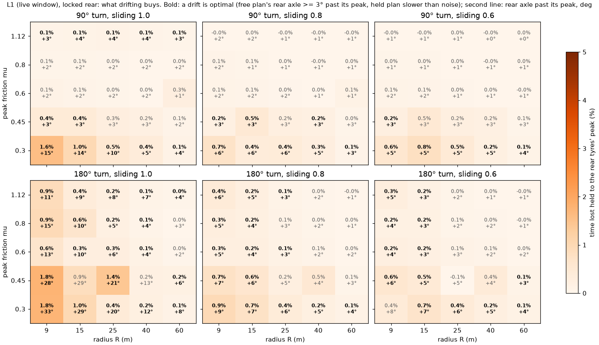
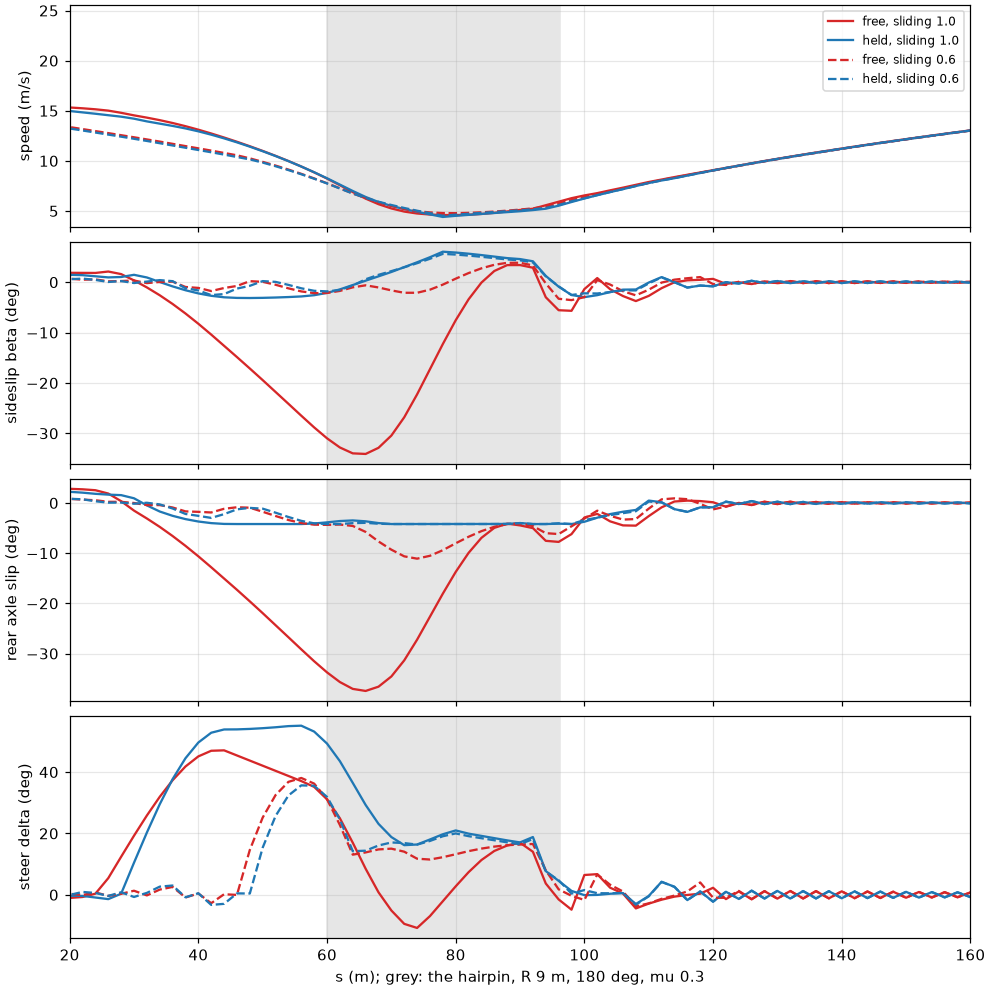

# When is a drift the fastest way round? The race planner's answer

Written 2026-10-30. The question: under which conditions does our planner's minimum-time
solution through a corner drift, and is it then actually faster than driving the same corner on
grip? The numbers come from `src/planning/race_planner/studies/drift_optimality.py`; its results
(csv, and every plan as npz) are in swb's `play_log/race_planner/drift_study/`.

## The answer

**In this model a drift is the fastest way round in two places, and it is never worth much:**

1. **Hairpins (180 deg, R <= 15-25 m) on every surface.** The free plan steps the rear tyres
   3-15 deg past their peak slip angle for a second or two at turn-in, and gains 0.2-0.9 %
   (0.02-0.09 s) at mu 0.6-1.12 over a plan held to the rear tyres' peak. On asphalt as swb models it (mu 1.12,
   sliding 0.8) that is 0.4 % in a 9 m hairpin, 0.2 % at 15 m, 0.1 % at 25 m, nothing beyond;
   on a 90 deg corner of any radius, nothing (0.00 %).
2. **Low friction (mu 0.3-0.45, snow, mud, loose sand): nearly every corner**, 90 deg ones and
   radii up to 60 m included. The gain is largest where the surface does not lose grip past the
   peak (sliding 1.0, mud and loose snow): 1.6-1.8 % (0.19-0.28 s) in 9 m corners at mu 0.3,
   with the body 33 deg sideways in the hairpin; 0.1-0.4 % at 40-60 m.
   **Revised by roadmap 061 M2** (each surface's own tyre peak, as swb gives Isaac; see
   Caveats and `mode-choice-m2.md`): far fewer corners (mu 0.3-0.45: 18 of 60 cases, not 43),
   about 1.2 % where the surface does not fall off (mud, sand, loose snow), 0.3-0.6 % in
   loose-ground hairpins, none on ice.

Where it does not pay: high friction with a surface that falls off past the peak (asphalt,
concrete: sliding 0.8, 0.6), on anything but a tight hairpin. There the plan drives on grip,
the rear tyre at most 1-2 deg past its peak, and holding it to the peak costs a few
milliseconds at most (none on 90 deg corners).

The question's own definition (the body's sideslip beta >= 5 deg free, slower with |beta| <= 2
deg) says otherwise -- "drift" in 124 of 150 cases, up to 25 % slower when held -- and is
misleading for this car: see *Sideslip is the wrong test here*. The answer above uses the
rear axle's slip angle against its tyre's peak instead, the textbook meaning of a drift.

Does a drift keep the speed up through a deep (170 deg) turn? No: on asphalt the drift line is
0.1-0.2 m/s *slower* at its slowest, exits at the same speed and dissipates more in the tyres;
it wins by rotating the car 0.06-0.21 s sooner and entering a little faster. On snow it is a
little faster at the apex and exit (up to 0.26 m/s), only because the plan held to grip ploughs
the front; see *A deep turn*.

The structure of the gain:

- **Fall-off past the peak is what decides it on high friction.** With no fall-off (sliding
  1.0) the free plan slides the rear 3-11 deg past its peak in every corner on asphalt, power
  on (request +0.4-0.6 m/s^2, rear slip ratio 0.06-0.1, front countersteering up to 6 deg on the
  big radii); with swb's asphalt fall-off (0.8) only the hairpins keep a short slide.
- **The rotation of a hairpin is what a slide buys.** Turning 180 deg in 30 m takes yaw the
  front tyres alone deliver slowly; stepping the rear out at turn-in (under braking or coasting,
  steer 9-13 deg, about a second) rotates the car early. A 90 deg corner of the same radius
  gains a tenth of it or nothing.
- **On low friction the slide starts under braking.** At mu 0.3 the free plans brake into the
  corner with the rear already past its peak, from the braking zone to the apex (4-10 s past
  the peak, request -0.2 to -0.5 m/s^2, rear slip ratio -0.03 to -0.1), the car rotated before
  it turns: trail braking. drift_mustang's ECU brakes the rear first (it regenerates up to 2.8 kN
  at the rear tyres, where the rear axle carries about 2.1 kN at mu 0.3), which looked like the
  cause; it is not. With the regeneration off (`regen` arm) every low-friction case still
  drifts, and the slide is worth more, not less (up to 2.7 % against 1.8 %).
- **The stable-branch rows do not forbid it.** A drift here is a slip *angle* past the peak with
  the slip ratio small, which the rows (dFx/dkappa >= 1 % of the stiffness, |kappa| <= 0.6) allow.
  With them off (`l1_relaxed`) the plans and gains are the same to within about 0.01 s.

## Method

**The section.** A straight entry of 60 m, a curvature ramp of 8 m up to 1/R, the arc, a ramp
of 8 m down, and straight to 360 m; the road 8 m wide (Haruna's). R 9, 15, 25, 40, 60 m;
turns of 90 and 180 deg. The car starts at the section's start on the centre line, straight, at
sqrt(mu g R + 1.2 mu g 50 m) (at most 30 m/s): the corner's point-mass speed plus what 0.6 mu g
brakes over 50 m, so braking into the corner is part of the problem. The time is read 50 m past
the corner's end ramp (the plan runs on to 360 m so its end conditions are far away).

**The solver: the live L1 window, one solve over the whole section.** `window.Window` with ds
2 m and length 360 m: the live planner's own problem (axle.py's car: steering rate and one
acceleration request, the ECU's split of it into wheel forces, PhysX's tyre on every wheel at
its own slip, the stable-branch rows, |kappa| <= 0.6, the motor's torque, power and rpm, the
brakes, the road's edges), solved with grip share 1.0 (the map's friction as the model's), cold
(IPOPT's own start), tol 1e-6. A window ends with |vy/vx| <= 0.15 and |xi| <= 0.35 rad at
360 m, no speed bound; with 54-228 m of straight after the timing point that end condition
costs both plans the same. One window over the section is a fair minimum-time comparison; the
receding chain the live loop runs would only add its own horizon effects.

**Free and held.** Each case is solved free and held, each from two starts: the
minimum-curvature line with the quasi-steady speed (`window.initial`), and the other solve's
result (clipped into the held one's bound). The best of each is compared; the spread over the
starts is the solver's noise for that case (at the 2 ms floor in most cases, at most 0.28 s, on snow hairpins
where IPOPT finds several local optima). A case counts as a drift only if the held plan is
slower by more than that noise (and at least 2 ms). A solve counts if IPOPT says
Solve_Succeeded or Solved_To_Acceptable_Level, its shooting defect and row violations are under
1e-3 and it stays on the road (within 5 cm). In 144 of the 150 rear-held cases every solve
did; in the other 6 one start failed and the case rests on the other.

Two holds, both new optional kwargs of `Window` (and of `ocp.solve_min_time`), None by default,
so the live planner is unchanged:

- `beta_max`: |beta| = |atan(vy/vx)| <= 2 deg, the question's own definition;
- `rear_alpha_max`: the rear axle's slip angle |atan((vy - lr r)/vx)| <= the rear tyre's peak
  slip angle + 1 deg, the peak taken from the planner's own tyre (`model.tyre`, pure lateral
  slip) at the outer rear wheel's load at the limit (1 + 0.6 mu rest loads), the smallest angle
  within 0.5 % of its largest force. The 1 deg is for PhysX's lateral slip, which is over |vx| + 1
  where the bound is over vx. A drift is then a free plan whose rear axle goes at least 3 deg past
  that peak, and is faster than the held one by more than the noise.

Each hold is two linear rows per stage (|vy - c r| <= tan(bound) vx), so a held window is as
quick to solve as the free one; `test_window.py::test_a_sideslip_bound_holds_and_costs_no_less_time`
checks the bound holds and costs no less time.

**Surfaces.** Peak mu 1.12 (asphalt), 0.8, 0.6, 0.45, 0.3 (snow, mud); sliding share 1.0 (no
fall-off: mud, loose snow), 0.8 (asphalt, concrete, packed snow), 0.6 (ice-like). The planner's
grip share (0.92 live) multiplies mu and nothing else, so it moves a case down the mu axis: the
live planner on asphalt is the 1.03 row, between the 1.12 and 0.8 rows below.

## The map

`drift-optimality-map.png`: per sliding share (columns) and turn (rows), the time the
rear-held plan loses (colour and first line, %) and how far past its peak the free plan's rear
axle goes (second line); bold where a drift is optimal.

| peak mu | sliding | 90 deg: drift wins at R (max gain) | 180 deg: drift wins at R (max gain) |
|---|---|---|---|
| 1.12 | 1.0 | 9-60 (0.10 %, 7 ms) | 9-60 (0.90 %, 0.07 s at 9 m) |
| 1.12 | 0.8 | none | 9, 15, 25 (0.40 %, 0.03 s at 9 m) |
| 1.12 | 0.6 | none | 9, 15 (0.28 %) |
| 0.8 | 1.0 | none | 9-40 (0.95 %, 0.09 s) |
| 0.8 | 0.8 / 0.6 | none | 9, 15 (0.28 / 0.16 %) |
| 0.6 | 1.0 | none | 9-40 (0.64 %) |
| 0.6 | 0.8 / 0.6 | none | 9, 15, 25 / 9, 15 (0.25 / 0.22 %) |
| 0.45 | 1.0 | 9, 15 (0.43 %) | 9, 25, 60 (1.76 %, 0.23 s); 15, 40 slide 13-29 deg but within noise |
| 0.45 | 0.8 | 9, 15, 40 (0.50 %) | 9, 15 (0.72 %); 25-60 within noise |
| 0.45 | 0.6 | 9 (0.23 %); 15, 40 within noise | 9, 15, 60 (0.57 %); 25, 40 within noise |
| 0.3 | 1.0 | 9-60 (1.57 %, 0.19 s) | 9-60 (1.75 %, 0.28 s) |
| 0.3 | 0.8 | 9-60 (0.71 %) | 9-60 (0.95 %, 0.15 s) |
| 0.3 | 0.6 | 9-60 (0.79 %) | 15-60 (0.68 %) |

"Wins" with a gain of 0.1 % or less (the 90 deg corners at mu 1.12 sliding 1.0) are real
optima in the model but a few milliseconds: no tracker on a real car will find them.

`drift-optimality-hairpin.png`: the 9 m hairpin at mu 0.3, free (red) and held (blue), sliding
1.0 (solid) and 0.6 (dashed). With no fall-off the free plan yaws the car from 30 m before the
corner, the rear 37 deg sideways at its entry, countersteers 10 deg at the apex and is 0.28 s
ahead of the held plan, which turns the front to near its lock before the corner instead. With
fall-off (0.6) the free plan keeps the rear within 11 deg (8 past the peak) and the two are
0.07 s apart, inside that case's noise (0.10 s): undecided.

## Sideslip is the wrong test here

The question's test (beta >= 5 deg, and slower held to 2 deg) finds a drift in 124 of 150
cases and up to 25 % lost when held, on asphalt at R 60 m too. That is not drifting: PhysX's
brush tyre saturates at tan(alpha) = 3 mu Fz / C, so its peak slip angle grows with the
friction -- 2.9 deg at mu 0.3, 10-15 deg at mu 1.12 (with no fall-off; 8.6-12 deg with swb's
fall-off starting at the rig's 8.6 deg). Gripping at the limit on asphalt therefore takes a rear
slip angle of 10-15 deg and a body sideslip of 6-12 deg, and holding |beta| <= 2 deg keeps the
rear tyres far below their peak, losing grip, not a drift. On snow the opposite: 5 deg of
sideslip already puts the rear past its tyre's 3 deg peak. A slip-angle threshold that does not scale
with the tyre's own peak cannot tell grip from slide across surfaces; the rear axle against its
peak can.

(Whether the real drift_mustang's tyres peak that late is the PhysX rig's: swb's surface layer
rescales each class's stiffness so the tyre peaks at the class's `peak_slip_angle`, 6-14 deg;
the planner's tyre does not, see Caveats.)

## The other arms

- **`l1_relaxed`: the stable-branch rows off** (SLOPE_MIN -1e3, KAPPA_MAX 1.0, patched before
  the window is built; 36 cases, mu 1.12/0.6/0.3, sliding 1.0/0.6, R 9/15/40, both turns). The
  same plans: rear past its peak within 1 deg of L1's, gains within about 0.01 s, the same
  cases drift but one (mu 1.12, sliding 0.6, R 15 hairpin: 3.5 deg past the peak, 0.014 s, which
  its noise leaves undecided). The rows that keep L1 off the tyre's falling branch in slip ratio
  do not exclude a slide in slip angle, which is the drift this car does. One relaxed case (mu
  0.6, sliding 1.0, R 9 hairpin) gave no usable plan.
- **`l0`: ocp.py's two-track car, locked and open** (each wheel's speed an input, no ECU
  coupling, no stable-branch row; R 15 hairpin, sliding 1.0). Locked: drifts at every mu, 10-21
  deg past the peak, gains 0.54 % (mu 1.12), 1.29 % (0.6), 1.33 % (0.3): larger than L1's (0.37,
  0.27, 0.99 %), since free wheel torques can drive and brake the rear as a drift wants, which the
  ECU's one request cannot. Open: drifts too, gaining about half as much (0.30, 0.62, 0.51 %): an
  open differential splits the torque equally and the unloaded inner wheel limits it, where a
  spool drives both rear wheels at one speed and turns the car with the difference of their
  forces. L1 models only the locked axle (the car's: a spool), so the open arm is L0's alone.
  L0 is slow (about 9 min a case) and failed to converge on one held solve (mu 1.12, locked,
  Restoration_Failed; the case is decided by its other start).
- **`regen`, `power`, `grade`**: see below.

**`regen`: the ECU's regeneration off** (regen torque and power 0; 16 cases, mu 0.3/0.45,
sliding 1.0/0.6, R 9/15, both turns). All 16 drift, and gain more than with it: 0.4-2.7 %
(0.04-0.44 s) against 0.2-1.8 % with it (and three cases the base map left within noise are
decided). So the rear-first regeneration does not cause the low-friction slides; if anything it
takes some of their value away.

**`power`: the motor at half and twice its torque and power** (24 cases, hairpins, R 9/15,
mu 1.12/0.6/0.3, sliding 1.0/0.6). Hardly a change: at the 5-15 m/s of these hairpins even
half the motor is more than the rear tyres carry. Half the power takes the asphalt
no-fall-off slide from 11 to 8 deg past the peak and its gain from 0.90 to 0.56 %; twice the
power raises it to 1.04 %. At mu 0.6 and above the other gains move by 0.03 % at most. At mu 0.3
they move by up to 1.2 % either way, which is that surface's solver noise (0.1-0.2 s), not the
motor. Only the power-on slide of a no-fall-off surface at high friction uses the motor.

**`grade`: 8 % downhill** (12 cases, hairpins as above). The slide grows where the surface does
not fall off: asphalt sliding 1.0 at 9 m 16 deg past the peak (11 flat), gain 1.44 % (0.90);
mu 0.6, 20 deg past (13), 0.97 % (0.64); mu 0.3, 42 deg past (33), 2.0 % (1.75). With fall-off
(0.6) it hardly moves (0.13-0.38 % against 0.15-0.28). Gravity along the road adds to the
braking the corner needs. At mu 0.3 with fall-off
neither plan stays on the road: the entry speed rule ignores the grade, and at 0.3 g less 0.08
g of gravity the car cannot slow to the corner in 50 m. At mu 0.3, R 15, sliding 1.0 the
spread over starts (0.9 s) leaves the case undecided.

## A deep turn (170 deg): does a drift keep the speed up?

No, not on asphalt; a little on snow, and not because it slides. Grid `deep` (9 cases, L1,
locked rear; free against the rear held to its peak) and `deep-report` (the speeds, the
energy, where the slide is, and the tyres' sliding loss, sum of Fx (omega R - lx) - Fy ly over
the four wheels; `deep_speeds.csv`). Turn-in is the start of the curvature ramp (s 60 m), the
corner's end the end of the ramp out; "half turned" is where the car's heading has turned 85
deg; "power on" the first node after the slowest with a request over 0.5 m/s^2.

| surface, R | plan | turn-in | slowest (where) | corner end | 50 m on | KE lost | slide (request) | half turned | sliding heat | section |
|---|---|---|---|---|---|---|---|---|---|---|
| asphalt 0.8, 9 m | free | 14.53 | 8.85 (80 m) | 11.51 | 25.23 | 56.9 kJ | 66-80 m (+0.03, coasting) | 74.5 m, 3.79 s | 198 kJ | 8.309 s |
| | held | 14.36 | 8.95 (76 m) | 11.52 | 25.22 | 53.2 kJ | - | 75.3 m, 3.89 s | 187 kJ | 8.340 s |
| asphalt 0.8, 15 m | free | 17.67 | 10.59 (90) | 14.52 | 26.83 | 73.6 | 72-90 (+0.2) | 83.7, 3.91 | 238 | 8.514 |
| | held | 17.61 | 10.72 (88) | 14.47 | 26.80 | 73.2 | - | 84.6, 3.99 | 230 | 8.534 |
| asphalt 0.8, 25 m | free | 21.61 | 13.92 (106) | 18.68 | 29.25 | 85.6 | 80-102 (+0.24) | 96.8, 4.12 | 311 | 8.968 |
| | held | 21.56 | 14.06 (104) | 18.64 | 29.23 | 85.1 | - | 97.6, 4.18 | 304 | 8.976 |
| asphalt 1.0, 9 m | free | 15.35 | 8.84 (80) | 11.89 | 26.17 | 68.4 | 64-82 (+0.46, power) | 73.0, 3.54 | 267 | 8.021 |
| | held | 14.96 | 9.01 (76) | 11.95 | 26.17 | 58.5 | - | 74.6, 3.75 | 232 | 8.081 |
| asphalt 1.0, 15 m | free | 18.29 | 10.80 (90) | 15.07 | 27.82 | 77.7 | 68-92 (+0.36) | 81.5, 3.65 | 319 | 8.241 |
| | held | 18.20 | 10.92 (88) | 14.99 | 27.77 | 77.2 | - | 83.8, 3.83 | 292 | 8.270 |
| asphalt 1.0, 25 m | free | 22.37 | 14.20 (106) | 19.41 | 30.32 | 89.5 | 70-110 (+0.63) | 93.4, 3.79 | 443 | 8.683 |
| | held | 22.20 | 14.41 (104) | 19.32 | 30.26 | 86.6 | - | 96.3, 3.99 | 408 | 8.700 |
| snow 0.3 (1.0), 9 m | free | 8.22 | 4.71 (80) | 5.98 | 11.90 | 23.1 | 34-96 (-0.21, braking) | 72.7, 6.46 | 127 | 15.678 |
| | held | 8.14 | 4.63 (72) | 5.72 | 11.77 | 24.3 | - | 78.6, 7.48 | 91 | 16.017 |
| snow 0.3 (1.0), 15 m | free | 10.06 | 5.89 (86) | 7.56 | 12.78 | 32.0 | 32-114 (-0.23) | 81.8, 6.88 | 136 | 16.022 |
| | held | 10.00 | 5.80 (84) | 7.44 | 12.73 | 32.4 | - | 86.9, 7.65 | 97 | 16.185 |
| snow 0.3 (1.0), 25 m | free | 12.38 | 7.81 (98) | 9.68 | 14.14 | 43.1 | 34-136 (-0.30) | 97.3, 7.61 | 137 | 16.746 |
| | held | 12.35 | 7.54 (94) | 9.65 | 14.12 | 43.1 | - | 100.8, 8.05 | 102 | 16.816 |

Speeds in m/s; the free plan is faster in all nine by more than its noise (asphalt 8-60 ms,
0.1-0.75 %; snow 70-340 ms, 0.4-2.2 %).

**On asphalt the drift trades speed for rotation.** The slowest point is *lower* with the slide
(0.09-0.21 m/s) and 2-4 m later, the speed at the corner's end the same within 0.09 m/s and 50 m
on within 0.06 m/s. What the slide buys is earlier yaw: the car has turned half the corner
0.8-2.9 m and 0.06-0.21 s sooner, and it enters 0.05-0.4 m/s faster (it can brake later, because
the slide does part of the turning). It costs energy: the tyres turn 2-15 % more of the car's
energy into heat sliding (198 against 187 kJ in the 9 m corner on asphalt, 443 against 408 at
25 m without fall-off), and the corner loses as much kinetic energy or more (57 against 53 kJ).
Sliding is a loss, not a way to keep speed: the gain is that the rotation is done sooner, so the
exit straightens sooner, and the faster entry is paid for by the same exit speed. With swb's
asphalt fall-off (0.8) the slide is a coast (request +0.03-0.24) for 14-22 m around turn-in;
without fall-off it is power on (+0.36-0.63) through the apex.

**On snow the drift keeps a little more speed, because the alternative ploughs.** The free plan
is faster at its slowest in all three (0.08-0.27 m/s); at 9 m it is 0.26 m/s (4 %) faster at
the corner's end, 0.13 m/s 50 m on, and loses 1.2 kJ less (23.1 against 24.3). It
slides from 26-28 m before turn-in, braking (request -0.2 to -0.3), the rear 24-36 deg out, and
is half turned 1.0 s (9 m), 0.8 s (15 m), 0.4 s (25 m) sooner. The held plan, its rear kept at
the 3 deg peak, can only turn with the front: it steers to near the lock and the front slides
instead, slowest earlier (72 against 80 m) and still turning when it should be accelerating. The
free plan's tyres dissipate 34-40 % *more* (127 against 91 kJ at 9 m), so the speed it keeps is
not saved from sliding; it is what the held plan loses ploughing the last part of the turn at a
lower speed. The drift's own currency is again time: the corner's rotation done 0.4-1.0 s
earlier, which on snow, where a front tyre alone turns the car slowly, is worth 0.07-0.34 s.

## Caveats

- **A model's optimum, not the car's.** The tyre is PhysX's brush with swb's fall-off as the
  planner writes it (model.tyre): quasi-static loads, no relaxation length (swb's asphalt has
  0.5 m), no tyre temperature, no Stribeck. The plans are minimum-time on that model; Isaac
  drives PhysX's own, and a slide's gain of 0.3 % is far inside the model's error at the limit
  (the planner keeps 8 % of the grip back for exactly that, and grip share is equivalent to
  lower mu here).
- **The surface's own peak (fixed in roadmap 061 M2, `docs/mode-choice-m2.md`).** This study
  ran on the rig's stiffness on every surface: on low friction its tyre saturated at 2-3 deg
  and kept the full peak flat to the rig's 8.6 deg, where swb's fall-off began, so a slide's
  first 5 deg cost nothing. swb scales each wheel's stiffness so the tyre peaks at the class's
  own `peak_slip` / `peak_slip_angle` (snow_packed 6 deg, gravel 12, mud 12, ice 3); the planner
  now does too (`model.tyre(surface=...)`, `SurfaceTable.tyre`, checked against swb's code).
  Re-run on it (`m2-lowmu`, `m2-classes`): the mu 0.45/0.3 rows above shrink from 43 of 60
  drift-optimal cases to 18, the classes from 53 of 80 to 32. A drift stays optimal where the
  surface does not fall off (mud, sand, loose snow, sliding 1.0: about 1.1-1.3 %, against
  1.5-2.5 % here) and in hairpins of R 9-25 on loose ground (0.3-0.6 %); on packed snow only in
  hairpins (0.34 %, not 1.95), on ice nowhere. Every low-friction section is also 1-4 % slower
  on the new tyre. The table and the low-friction bullets above are the old tyre's.
- **Solver.** Local optima on low friction: the noise (the spread over starts) reaches 0.28 s on
  mu 0.45 hairpins, where 8 of the 20 mu 0.45 cases are left undecided. More starts
  (continuation in mu) would settle them. In 6 of the 150 rear-held cases one start failed (one
  "infeasible" at mu 0.3), and the case rests on the other.
- **One section shape, one entry speed rule, one car.** A different entry speed or a corner
  sequence (a slide to set up the next corner) can change the hairpin results; the car is
  drift_mustang (50:50, 330 kW rear motor, spool, 58 deg lock).

## How the planner finds its optimum, and what a GPU would change

Both layers optimise by derivatives, not by sampling. L1 (window.py) is a direct transcription:
the 200-260 m window is 50-65 nodes 4 m apart, each with the state (n, xi, vx, vy, r, delta)
and the controls (steer rate, the acceleration request, the wheels' peripheral speeds), the
model's step between nodes, the car's limits, the road's edges and the tyre rows as
constraints, and the time (the sum of ds / s-dot) as the cost. CasADi builds it symbolically,
differentiates it exactly (gradient, constraint Jacobian, Lagrangian Hessian, by algorithmic
differentiation) and compiles it to C; IPOPT, an interior-point method, takes Newton steps on
it, each one sparse linear solve (MUMPS, the default). Warm-started from the previous plan it
converges in tens of iterations: on Haruna, with the live model (PhysX tyres, seven controls), p50
0.27 s, p95 0.91 s, p99 1.04 s on one core (window.py's docstring). L2
(tracker.py) is a real-time iteration: the same model linearised about the plan each tick, one
QP solved by HPIPM at 50 Hz.

A derivative method finds a local optimum, the one its start leads to. That is this study's
undecided cases (8 of 20 at mu 0.45): grip and drift are separate optima, and a warm start
stays in its own.

**Why differentiation cannot choose between grip and drift.** Nothing in the model is
discrete: the rear's slip angle, the steering and the request are all continuous, and no mode
variable says "drift". The obstacle is that the problem is not convex. The tyre's force rises
to a peak and falls past it, so the time over a window has several valleys: grip, the rear
stepped out at turn-in, and others. Between them lies a ridge: a half-slide (the rear 1-3 deg
past its peak) loses the grip without buying the rotation, or runs wide off the road, and is
slower than either. A Newton step only goes down from where it starts, so the solver stays in
its start's valley. A gradient describes the slope where the solver stands; it says nothing of
a valley over the ridge.

Some of the choices really are discrete:
- which way the car rotates: a pendulum (Scandinavian) flick slides the other way first, and
  between the two lies a slide of zero, the worst in between;
- when the slide starts: on the brakes before the corner, or on the power at the apex;
- switched events (a wheel locking, ABS cycling, a gear), which the model smooths or leaves out.

What handles it, in order of fit for L1:
1. **Seeded multi-start.** The same window solved in parallel from two or three starts, each
   seeded in one mode (the previous plan, a rear-out-at-turn-in guess, perhaps a flick), and
   the fastest feasible plan kept. A warm solve takes 0.27 s at the median but 0.91 s at p95, so
   three cores fit the 1 s budget only just: a seed far from its valley takes more iterations,
   and one not feasible by the budget is dropped. The seeds make the discrete choice, the derivatives refine each one. The first fix
   to try.
2. **Continuation (homotopy).** Solve where a drift wins easily (no fall-off past the peak),
   then step the fall-off back to the surface's, following the solution: this carries the
   drift valley into the real problem. The study used it to make low-friction solves converge.
3. **A sampler picks the mode, the derivatives refine it** (MPPI or CEM on a GPU, then IPOPT).
   A sampler needs no slope, so it sees every valley at once, coarsely.
4. **Mixed-integer or complementarity formulations** (an explicit mode variable; a locked wheel
   as a complementarity constraint). Exact about the discrete choice, far too slow for a
   re-plan every second.

How much it matters: on asphalt the valleys lie within 0.4 % of each other, so the wrong one
costs almost nothing. On low friction they differ by 1-2 %, and the drift valley starts its
trail braking about 25 m before the corner, so the choice must be made early in the window.
That is where seeded multi-start pays.

**A GPU would not speed up this solver.** The problem is small (about 1000 variables) and
banded: each node is coupled only to its neighbours, so a Newton step is a sequential sparse
factorisation, and launch and transfer overheads would exceed the work. What does speed it up:
a linear solver that uses the stage structure (a Riccati recursion, as HPIPM and acados do, or
MA57/MA27 in place of MUMPS), fewer iterations, and a core of its own.

**A GPU is the tool for what derivatives do badly, choosing between optima:**

1. Sampling MPC (MPPI, model predictive path integral): thousands of noisy control sequences
   rolled out in parallel and averaged by their cost. It needs no derivatives, is indifferent
   to the tyre's fall-off and to grip-or-drift choices, and drove a 1:5 car sliding on dirt on
   a GPU (Williams et al., below). Its plans are coarse and it holds hard constraints (the road's
   edge, the motor's limits) only through penalties.
2. Multi-start: the same NLP solved from several starts per corner (a grip start, a drift start)
   and the fastest feasible plan kept. This attacks the local optima directly. CPU cores do it
   too; a batched GPU solver scales further.
3. Both: a sampler picks the mode (grip or drift, which way round), the derivative solver
   refines it into an exact, feasible plan, and L2 tracks it.

## What it means for the race stack

- On asphalt a drift is worth at most a few tenths of a percent, in tight hairpins only. The
  live planner may plan one there (it is optimal in the model), but there is nothing to chase:
  no setting should push the car into a slide on asphalt.
- On loose or low-friction surfaces it is worth 1-2 % and changes the line (trail braking into a
  slide from before the corner). Before that is relied on: the planner's tyre must take each
  surface's own peak slip angle (swb's surface layer rescales it, the planner's does not: 3 deg
  on snow against swb's 6), the open axle must be in L1 (it models the locked one only), and L1
  must look at both modes (multi-start, or a sampler choosing the mode).
- The GPU belongs there, on the mode choice, not under IPOPT.

## Literature

- Tavernini, Massaro, Velenis, Katzourakis and Lot, *Minimum time cornering: the effect of road
  surface and car transmission layout*, Vehicle System Dynamics 51(10), 2013. Minimum-time
  manoeuvres on a hairpin with a full car model on tarmac and on loose gravel: on the loose
  surface the optimum is an aggressive, large-sideslip technique, on tarmac far less so, and the
  transmission layout changes it. The same direction as here: a loose, low-friction surface and a
  tight corner for sliding, grip on tarmac. Our fall-off share plays the role of their surfaces'
  different force curves.
- Velenis, Tsiotras and Lu, *Optimality properties and driver input parameterization for
  trail-braking cornering*, European Journal of Control 14(4), 2008: trail braking (braking into
  the corner while the car rotates at a large sideslip), the rally technique, as the solution of
  a minimum-time cornering problem. Our low-friction hairpins plan the same shape: braking, and
  the rear sliding from before the corner to the apex.
- Williams, Drews, Goldfain, Rehg and Theodorou, *Aggressive driving with model predictive path
  integral control*, ICRA 2016, and Williams et al., *Information theoretic MPC for model-based
  reinforcement learning*, ICRA 2017: MPPI on a GPU driving the AutoRally car at the limit on a
  dirt track, sliding.
- Perantoni and Limebeer, *Optimal control for a Formula One car with variable parameters*,
  Vehicle System Dynamics 52(5), 2014: the spatial (curvilinear) minimum-time formulation ocp.py
  and window.py use.
