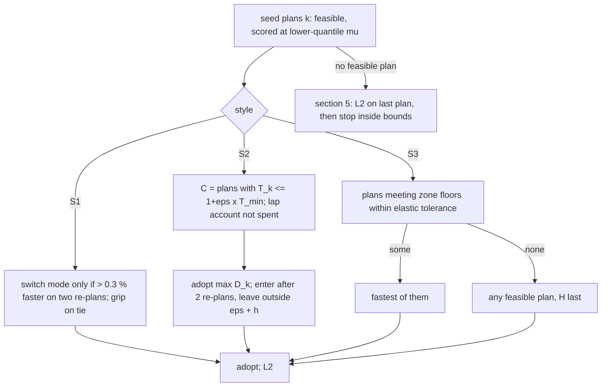

# Make drift style a choice of solvers

(Research report, 2026-10-31. Notes in `drift-style-notes/`: competitive drifting, autonomous drifting, and a style layer over the live race planner. Built on [mode-choice-methods.md](mode-choice-methods.md) and [preconditions.md](preconditions.md), grounded in the live race planner design's sections 4.4a and 10 ([design](superpowers/specs/2026-10-29-live-race-planner-design.md)) and the current state in [mode-choice-m4b.md](mode-choice-m4b.md). External claims carry links. Claims about our stack cite our own documents. Wherever the text says "inference", the conclusion is ours and no source states it.)

**A driving style should be a small record at the top of the planner. The record chooses which formulation each existing layer runs. It is not a weight added to L1's cost.** The three styles map onto three formulations, and each one reuses machinery we already have. **S1, fastest lap**, is today's planner, unchanged and bit-identical. **S2, drift where it costs little**, leaves the NLP alone and changes only the choice. The gate keeps every feasible seed plan within a time tolerance ε of the best one and adopts the one that drifts most. Asphalt adds one twist. There a drift's loss is the same size as the solver's 0.3 % noise, so the decision must come from an offline drift map that stores signed losses, spent against a lap-level budget. **S3, D1-style "drift everywhere, keep the speed"**, is still minimum time, now subject to a signed rear-slip floor and a speed floor inside zones that an offline zone plan marks. It adds a new seed for linked direction changes on straights (M, for manji) and gives L2 more weight on the plan's own slip. The style approach comes from how the sport is judged. D1 asks the car to be "as fast as possible ... while maintaining a large angle" and scores speed × angle + swing. That is a constrained minimum-time problem, not a free "maximise angle" objective. No autonomous-drifting paper trades lap time against drift: every one either tracks a drift it is given or lets drift emerge from minimum time. A weighted sum would also fail mathematically on our non-convex grip-or-drift problem. Style may change the objective, the seeds and the gate. It may never loosen g1, the edge margins, the slip caps, the friction quantile, the estimator's lower-only rule, H, or the stop. The largest open risks sit in the car and not in the planner. Our car turns one acceleration request into rear drive or a 50:50 brake split, so speed and drift angle cannot be set independently the way Stanford's brake-augmented controllers set them. On asphalt a held drift sits on the tyre's falling branch, the same unstable regime that lost ice in M4b.

## Every series judges line, angle and swing, and only D1 pays for speed

All four rulebooks score the same three things, in different proportions. **Line** means passing marked inner clips and filling outer zones. **Angle** means a large, *stable* body sideslip. **Style** means an early, fast initiation and a quick lock-to-lock transition, driven with committed throttle. D1 GP defines its single run as "a competition of driving skills to drive faster with a larger and more stable drift angle and to switch angles more quickly within a defined curved course". It scores **speed (out of 10) × stable large angle (out of 10) + sharp swing (0 to +3)**, for example 9.8 × 9.7 + 0.5 = 95.56. Since 2013 its DOSS unit measures these by GPS and gyro, and "scoring elements that can be scored by measurement shall be scored only by measurement" ([D1 2024 Appendix-B](https://entry.d1gp.co.jp/download_files/Data_4.24-01縲占ｦ丞援譖ｸ2024%20闍ｱ隱樒沿縲・English_2024_P28-31_D1謗｡轤ｹ蝓ｺ貅.pdf)). Formula Drift has moved even further toward measurement. In 2026 about **80 % of a PRO qualifying score is automated line and angle** (Race Data Labs' UDSM), and 20 % is style from the judges ([The Shop Magazine](https://theshopmag.com/news/formula-drift-race-data-labs-2026-udsm-qualifying-format-changes/)). Drift Masters weights **line 60, angle 20, style 20**, the style split into initiation 5, fluidity 10 and commitment 5 ([DM 2024](https://dm.gp/media/pkmbve3r/dm2024-judging-rules.pdf)). The FIA recommends **40 line / 30 angle / 20 style / 10 speed**, with speed defined as "a consistent average speed ... as opposed to the maximum speed" ([FIA guidelines](https://www.fia.com/sites/default/files/guideline_for_drifting_event_-_wmsc051218_-_clean_0.pdf)).

The rule text that matters most for a planner is D1's speed item. "The driving speed must be as fast as possible in any part of the course. Drifting angle and speed are inversely related, but the speed must be as fast as possible while maintaining a large angle." A "significant decrease in speed" costs a significant deduction. On angle, D1 says "the larger the angle, the better", and then adds two rules: "if the angle returns, points will be deducted", and "temporary large angles will not be evaluated" ([D1 2024](https://entry.d1gp.co.jp/download_files/Data_4.24-01縲占ｦ丞援譖ｸ2024%20闍ｱ隱樒沿縲・English_2024_P28-31_D1謗｡轤ｹ蝓ｺ貅.pdf)). Read as optimisation, this is **minimum time (or maximum speed) subject to a sustained angle floor**, with a penalty when β moves against the drift inside a sector. It is not "maximise angle". Drift Masters says the same from the other side. Its judges "do not want to see the lead driver driving fast and shallow". The FIA also deducts from a follower who "reduces his steering angle, in order to build up speed". A fast, shallow drift is the failure each series guards against, and a speed floor and an angle floor together are what rule it out.

Courses are scripted, and the scripts read like constraint lists. The FIA's judged section holds **3 to 7 curves**, between an acceleration section and a deceleration section ([FIA](https://www.fia.com/sites/default/files/guideline_for_drifting_event_-_wmsc051218_-_clean_0.pdf)). Drift Masters requires the car to be "sideways as it passes the single standing cone" of a 3-2-1 initiation sequence. It also publishes an **accel/decel map**: in green the car "must be accelerating or at very least maintaining speed", in orange only minor adjustment is allowed, and in red the car may slow ([DM 2024](https://dm.gp/media/pkmbve3r/dm2024-judging-rules.pdf)). A real course brief at Ahvenisto reads like a program. "Front right wheel into IZ2 and continue to OZ3 ... Decelerate after transition and fill OZ6". The same brief asks for "Deceleration by increased angle after transition" and "speed adjustment possible only after transition is finished" ([DM 2026 Rd4](https://dm.gp/media/p43d0rgm/dm26-rd4-finland-qualifying-battle-briefing_www.pdf)). That last instruction matters for our car (section 4). The sport's own way to lose speed in a drift is **more angle, not brakes**. Inner clips are touched with the front of the car and outer zones filled with the rear. At 30-50 deg of sideslip, the CG line therefore sits well inside the geometric outer edge (inference from the clip definitions). On D1, off course is "one wheel's tread outside the designated track", and all four wheels off costs 10 points ([D1 2016 Appendix-1](https://d1gp.co.jp/10_regu/img/2016gprg-1.pdf)).

Execution has a consistent physical story. **Throttle sets the angle and steering points the front along the path.** Driver61's coaching says to lift for less angle and add throttle for more ([Driver61](https://driver61.com/uni/how-to-drift/)). An instrumented expert on dirt held **β ≈ 32 deg at 8.1 m/s and 36 deg/s of yaw on a 13 m radius** at near-full throttle with counter-steer. On a 2 m radius he initiated with the handbrake and held **β ≈ 45 deg** while steering *into* the turn ([Velenis et al. 2011](https://dcsl.gatech.edu/papers/cep10.pdf)). A **transition** is a scheduled reversal of yaw moment: "slightly over-rotate just before changing direction, then lift off", let the wheel spin to opposite lock, and get back on throttle "quickly and firmly" ([Driver61](https://driver61.com/uni/how-to-drift/)). Stanford's MARTY ran a figure-eight at **50 km/h through ±40 deg of sideslip in about a second, with yaw rate up to 120 deg/s** ([Stanford DDL](https://ddl.stanford.edu/publications/journal/towards-automated-vehicle-control-beyond-stability-limits-drifting-along)). That sets the scale of a "sharp swing". D1 also takes its maximum-speed reading in the swing-back section, so a high score required "keeping speed into the swing-out and swinging back sharply" ([autosport web 2013](https://www.as-web.jp/past/d1グランプリ開幕戦舞洲は古口が総合優勝を飾る)). Drift Masters ranks initiations by weight transfer and clutch kick above the handbrake, and D1 deducts "using side brake too much" ([DM 2026 Rd4](https://dm.gp/media/p43d0rgm/dm26-rd4-finland-qualifying-battle-briefing_www.pdf); [D1 2024](https://entry.d1gp.co.jp/download_files/Data_4.24-01縲占ｦ丞援譖ｸ2024%20闍ｱ隱樒沿縲・English_2024_P28-31_D1謗｡轤ｹ蝓ｺ貅.pdf)). That fits our car, which has no handbrake as a separate input.

The record is thin in three places, and each matters here. **No rulebook publishes sideslip in degrees.** DOSS's internal formula is unpublished, and so is UDSM's. **No citable source describes the manji**, the alternating drift down a straight, even though practitioners use it widely. The best authority is DM's tandem rule that a lead "may use a 'flick'" across the track width "but can't lose momentum thanks to that (recommended to use only 2/3 of the track)" ([DM 2026 Rd4](https://dm.gp/media/p43d0rgm/dm26-rd4-finland-qualifying-battle-briefing_www.pdf)). Finally, **no series compares a drift run's time with a grip lap**. Competitive drifting has no notion of "drift where it costs little". S2 is our invention, not the sport's.

## Autonomous drifting tracks the drift it is given and never prices it in lap time

The Stanford line shows how a drift reference has been specified over time, and so what an S3 tracker needs. Goh's controller tracked **path and sideslip and left speed free** as a stable zero dynamic. It drove a nearly **1 km course at up to 40 deg sideslip, 2.5 rad/s yaw rate and 50 km/h**. Its figure-eight was planned offline as a nonlinear optimisation, and a supervisor that kept "steering authority over the rotational dynamics" was what stopped the car from spinning ([Goh thesis](https://purl.stanford.edu/th820zb4174)). Goel then made the drift "fully actuated" by **using brakes, steering and drive torque together**. For a given curvature, the drift equilibria grow from a curve to an area in the speed-sideslip plane, which gives "a way to remove energy while keeping sideslip and position under control". An *augmented* NMPC tracked figure-eights that switch direction ([Goel thesis](https://purl.stanford.edu/mz751hw3069)). Peterson's LQR around the equilibrium reached **centimetre-level** tracking on MARTY and extended to variable-speed drifting on the Supra ([Peterson thesis](https://purl.stanford.edu/vg668bz0151)). TRI's 2024 tandem gave the lead car the task of "tracking an ideal path at a high angle", with NMPC re-solved up to 50 times a second ([Green Car Congress](https://www.greencarcongress.com/2024/07/20240724-tri.html)). Each of these references was made offline or handed over as a task. None was chosen for lap time.

Optimisation papers fall into two camps, and neither fits S2 or S3 directly. **Minimum-time OCPs leave drift to emerge and at most bound it.** Zhao et al.'s minimum-lap-time drift planner minimises pure lap time with **|β| ≤ 30 deg as a constraint**. At μ 0.6 in CARLA its plan sits on that bound (29.9 deg), and its RL tracker loses 12-17 % of the planned time ([arXiv 2608.00113](https://arxiv.org/html/2608.00113)). **Drift-tracking NMPCs follow an equilibrium (β, r) looked up from curvature.** Meijer et al. run ACADO SQP at 50 Hz with N = 25. On a BMW M3 they held about 30 deg for several laps, wet and dry, with speed tracked worse than β and r ([arXiv 2405.10859](https://arxiv.org/html/2405.10859v1)). The switch between opposite sustained drifts, called "inertia drift", is studied only in simulation, as a planning problem that aims for "minimal velocity loss" ([Zhou et al. arXiv 2507.05748](https://arxiv.org/abs/2507.05748)). The one controlled drift-versus-grip time figure is a human in CARLA, **141.69 s drifting against 160.53 s driving normally** (about 12 % faster), on CARLA's tyre with the authors' friction setting ([Cai et al., RA-L 2020](https://ar5iv.labs.arxiv.org/html/2001.01377)). That number says more about the simulator's tyre than about tarmac. Our own map puts asphalt's best drift gain at **0.4 %** ([drift-optimality.md](drift-optimality.md)). Any S2 or S3 number we produce is a property of the planner's tyre per class and of Isaac's, and has to be measured on both.

The autonomous-drifting notes found **no Pareto front or ε-constraint study of lap time against drift angle**, for cars or for minimum-time vehicle dynamics in general. The closest antecedent is old. Velenis and Tsiotras showed in 2005 that a minimum-time cost and a maximum-exit-velocity cost produce different optimal cornering ([ISIE 2005](https://dcsl.gatech.edu/papers/isie05a.pdf)). So style through the choice of formulation has precedent, and style through a weight has none that applies. Three inferences from the notes shape the proposal. First, **speed keeping in a drift needs an independent way to remove energy**, such as front brakes or per-wheel torque on top of rear drive (Goel, Peterson). Without one, speed follows from sideslip and path (Goh). Second, the figure-eight lesson is that **transitions are where rotation-rate limits bind**. A planner should bound the rate of change of β and r through a switch and never hand the tracker a step in β. Third, **a drift on a straight is not a steady equilibrium.** With zero path curvature and no yaw rate, the axle lateral forces must cancel while the rear is sliding. A "drift on a straight" is therefore a chain of linked transients, a manji, which is the Zhou/Betz problem and not Meijer's lookup table. No published method plans one by optimisation beyond the figure-eight.

## A weighted sum cannot set the style, so each style takes its own formulation

The obvious design is "time + w × drift". It fails for four reasons, and the notes support each one. Weighted sums cannot reach the non-convex parts of a Pareto front ([Das and Dennis 1997](https://link.springer.com/article/10.1023/A:1010035730904)). Our grip and drift valleys, separated by the half-slide ridge, are exactly such a front ([mode-choice-methods.md](mode-choice-methods.md)). Even for convex priority-ordered MPC, "no single weight is valid across the sampled ticks of an episode" ([Hajieghrary et al., arXiv 2608.12520](https://arxiv.org/abs/2608.12520)). So no user can set w once and get the same behaviour on asphalt hairpins, mud sweepers and snow. A reward on |slip| or |β| without a cap pays the plan to spin. With a cap, it pushes every zone onto the cap, the very regime issue 002 showed no controller can hold (the free mud plan plowed the front at 9-21 times its peak, and every arm stopped, [mode-choice-m4b.md](mode-choice-m4b.md)). Finally, changing w moves the optimum continuously, so a warm start can be left in the wrong valley. That is the same seeding failure the multi-start exists to fix. The ε-constraint form inside the NLP (maximise drift subject to T ≤ (1+ε)T\*) needs T\* first, which means two sequential solves inside a budget whose p95 is already 0.91 s. It also replaces IPOPT's well-tested minimum-time objective with an untested "maximise slip" one. It belongs offline, where it can build the drift map's loss column.

**S2 fits a lexicographic order with a tolerance, applied across seeds instead of inside a solver.** The filter keeps the candidates within ε of the best on the first objective and then optimises the second over the survivors ([arXiv 2607.15508](https://arxiv.org/pdf/2607.15508)). L1 already produces a discrete candidate set, one plan per seed, each with a time T_k. Adding a drift measure D_k turns the existing gate into this filter at no extra solve, with no NLP change and with warm starts untouched. It is exact only over the valleys that were seeded, which is acceptable because the seeds already *are* the modes. **S3 fits mode-dependent constraints, the way D1 is scored.** It stays minimum time, subject to a signed rear-slip floor and a speed floor in zones. Fixing the drift direction per zone turns the disjunction |α| ≥ floor into one smooth valley, and the seed supplies that valley. This matches what racing stacks do with behaviour. TUM's A2RL stack sends an orchestration command carrying maximum velocity, overtaking permission and following distance, and scales acceleration limits per cell with a GripMap ([Hoffmann et al., arXiv 2602.08571](https://arxiv.org/html/2602.08571)). TRI's NMPC penalises exceeding "a designated maximum fraction of the friction circle" ([Dallas et al., arXiv 2304.12263](https://ar5iv.labs.arxiv.org/html/2304.12263)). Autoware turns planner modules on per preset and gives each its own parameter file ([Autoware docs](https://autowarefoundation.github.io/autoware_universe/main/planning/behavior_path_planner/autoware_behavior_path_planner/)). In each case **a record set at the top configures limits, enable flags and which modules run**, and it keeps grip scaling and margins out of any aggressiveness knob. Our g1 plays the role of TRI's friction fraction and our lower-quantile μ plays the role of TUM's GripMap. They are safety parameters, so the style record must not contain them.

The drift measure has to follow our tyre, not the judges' β. Body sideslip cannot tell grip from slide on this car. Gripping at the limit on asphalt already takes **10-15 deg of rear slip and 6-12 deg of body sideslip**, while on snow 5 deg of sideslip is past the tyre's peak ([drift-optimality.md](drift-optimality.md)). The planner already has the right definition. `modes.REAR_PAST` calls a plan a drift where its rear axle runs **3 deg past its tyre's peak**. D_k should be the distance-weighted share of a corner's or zone's nodes past that line, and β should stay a reported diagnostic for "does it look like D1". This creates a real tension in S3. D1 judges body angle, but our floor holds rear slip. On asphalt a rear floor just past the peak may give a body angle well under the 30-45 deg of a competition drift. That number is unmeasured, and the proposal makes a body-angle floor optional for exactly that reason.

## The proposal: a style record above the schedule, gate, window rows and L2

### The layer and what it touches

The style record is read once per re-plan. It configures five places in the stack and owns none of the safety pieces. The diagram shows the re-plan of design section 4.4a with the style layer on top. Everything in the right-hand box is fixed whatever the style.

```
                      STYLE RECORD  (fastest | drift_budget | drift_max; refused by name at load, never clamped)
                      read at each re-plan; a change applies at the next one, never < 25 m
                      before a committed drift zone
     .------------------+-----------------+-----------------+-----------------+-------------.
     v                  v                 v                 v                 v             |
 OFFLINE / L0       SCHEDULE          L1 WINDOW         GATE (choose)      L2 TRACKER       |
 drift_map.json     schedule.py       window.py         MultiStart.choose  tracker.py       |
 S1: gains          S1: G,H,D,F as    S1,S2: 060's      S1: >0.3% x2,      S1,S2: plan      |
 S2: + signed       today (4.4a)      rows +            grip on tie        refs, today's    |
     losses         S2: + D where     slip_rows         S2: lex-eps:       weights          |
 S3: + zone plan    map loss <= eps   S3: + elastic     T_k<=(1+eps)Tmin,  S3: x3-5 on      |
     (where, which  S3: D every zone, signed rear-slip  max D_k, exit at   slip/yaw refs,   |
     way, swings),  M on straights,   floor, speed      eps+h, budget      soft slip floor, |
     M library      F at S-bends,     floor, swing-rate S3: feasibility    "recover to grip |
                    G + H always      bound, no-return  + fallback only    then stop"       |
     |                  |                 |                 |                 |             |
     '------------------+--------> L1 seeds in parallel (one core each, cut ~0.9 s) ---> adopt
                                                                                            |
   INVARIANT (no style may touch; a style may only tighten): g1 = 0.92 | edge-type margins  |
   (widen only) | window.slip_rows caps (front <= 1x, rear <= 3x peak where no fall-off;    |
   ice rear at peak) | friction at the lower quantile | estimator lowers only and holds     |
   through a slide | H as grip fallback | L0/qss end-speed bound | stopping-distance stop | |
   section 5 failure table | FREE_STAGES 12 m <-------------------------------------------'
```

### The style record

The record has about a dozen fields. It is validated at load against the invariants and refused, not clamped silently, when a field breaks one. This follows the repo's practice of refusing a bad setting by name rather than aliasing it.

```yaml
style:
  name: fastest            # fastest (S1) | drift_budget (S2) | drift_max (S3)
  # S2: the time the user will give up for drift
  eps_lap_s: 0.0           # seconds per lap, spent through a running account (preferred)
  eps_window: 0.0          # or relative per window; refused below 0.003 (the noise floor), above 0.03
  exit_hyst: 0.003         # h: leave a drift once it falls outside (1 + eps + h) on two re-plans
  # the drift measure, shared by S2's gate, S3's floor and every test
  drift_past_deg: 3.0      # rear axle this far past its peak counts as drifting (modes.REAR_PAST)
  # S3: what a zone asks of the plan
  zones: auto              # auto (from edge type, width, class, geometry) | path/to/zones.yaml
  straights: true          # allow manji zones on straights; false = corners and S-bends only
  slip_floor_past_deg: 3.0 # sign_z * alpha_rear >= alpha_peak + this, inside zones (elastic)
  beta_floor_deg: null     # optional body-angle floor for a D1 look; off by default
  speed_floor: 0.10        # v >= (1 - speed_floor) * v_ref(s) inside zones (elastic)
  swing_rate_max: 2.0      # rad/s on beta through a zone's switch interval
  width_use: 0.67          # share of the drivable width a manji may sweep (DM's 2/3)
  classes: [mud, sand, snow_loose, gravel, dirt, grass, snow_packed, asphalt]  # ice never
  l2_slip_gain: 1.0        # multiplier on L2's sideslip and yaw-rate weights (S3: 3-5)
  ecu_mode: race           # ECU traction control and ESC profile the style needs (see risks)
```

The load-time clamps follow from the invariants. On a class with `window.slip_rows`, the slip floor must sit below the rear cap: peak + `slip_floor_past_deg` < 3 × peak, which holds for any peak above 1.5 deg. `ice` is refused in S3's classes, and ice keeps M4b's rear held at its peak in every style. The speed floor may never lift a node above the window's own end bound (L0's `v_max(s)` or `qss.py`) or past the stopping distance. `width_use` and every zone's sweep sit *inside* the edge-type margins. Those margins are a floor that a style may widen, never narrow. g1, the margins, the friction quantile and the estimator's rules are not fields at all. S1's record (`name: fastest`, all else default) must produce today's plans bit for bit. That keeps M4b's R6 result (Haruna 0.000 %) as a permanent regression test of the plumbing.

### What each style toggles, layer by layer

| layer | S1 fastest | S2 drift ≤ ε | S3 drift max (D1) |
|---|---|---|---|
| L0 / offline | corner library, `drift_map.json` (gains) | + **signed losses** per cell (forced-drift ε-constraint solves, offline) | + **zone plan** (where, which way, switch intervals, speed-floor reference); + **M library** (manji seeds by straight length × speed band, by continuation) |
| schedule (`schedule.py`) | today's table (4.4a) | + D (and F into hairpins) where the map's loss ≤ the remaining budget; never where a forced drift is infeasible | D in every zone; **M** on straight zones; F at S-bends; G and H always (fallback and v_ref) |
| L1 objective | min time | min time | min time |
| L1 rows (`window.py`) | `slip_rows` where no fall-off | same | + elastic signed rear-slip floor, speed floor, swing-rate bound in switch intervals, no-return penalty; optional β floor |
| gate (`MultiStart.choose`) | > 0.3 % twice, grip on tie, lower quantile | **lex-ε**: keep T_k ≤ (1+ε)·T_min, adopt max D_k; enter after two re-plans, leave outside ε + h; debit the lap account | feasible and inside the zone's floors first, fastest of those; else any feasible, H last |
| L2 (`tracker.py`) | plan's β, r as references | same | ×3-5 on β, r inside zones; soft slip floor; fallback recovers to grip, then stops |
| ECU | as configured | as configured | traction control and ESC set not to cut a planned slide (risk 1) |
| invariants | all | all | all |

**S2 in detail.** Within one re-plan, the gate scores every feasible seed at the lower friction quantile, as it does today. It forms C = {k : T_k ≤ (1+ε)·min_j T_j} and adopts the plan with the largest D_k, taking the faster one on a tie. Hysteresis mirrors today's two-re-plan rule. A drift is entered when a D plan stays in C on two re-plans and left when it falls outside (1 + ε + h) on two re-plans, with h at the 0.3 % noise floor. One fact from our measurements changes how ε is expressed. The cheapest asphalt drifts we know of are D into Haruna's R 9.9-11.2 m hairpins. Together they cost **0.09 s a lap on the plant, in three of three repeats** ([mode-choice-m4b.md](mode-choice-m4b.md)). That is about 0.12 % of a 76 s lap, but per hairpin and per window it is the same size as the 0.3 % noise that the gate exists to ignore. **So on asphalt, the per-window comparison cannot tell S2's "costs a little" from noise.** The decision has to come from the offline map's signed loss, spent against a lap account. The user sets `eps_lap_s` (say 0.2 s). Each scheduled drift debits the account by its mapped loss, and the schedule stops adding D once the account is spent. The best use of the budget is a knapsack: the most drift per second lost, planned from the map before the lap. On low friction the question mostly disappears, because drift already pays 1-2 % in nearly every corner on classes without fall-off. There S2 reduces to S1 plus the marginal corners (wide-road 90s, where the M3b width arm measured 0.05-0.2 %). The relative `eps_window` stays as a fallback for courses without a map, and it is refused below the noise floor.

**S3 in detail.** The **zone plan** is the planner's version of a D1 or DM course map, and it must exist before the solver. Drift direction is a discrete choice that a gradient cannot make, because a flick has a zero-slide ridge between its two directions ([mode-choice-methods.md](mode-choice-methods.md)). `zones: auto` builds the plan from data the map already holds. Corners get a zone in their natural direction. S-bends get a switch interval at the curvature sign change. A straight gets a manji, alternating zones with switch intervals spaced by speed band, only when `straights: true`, the width minus the edge-type margins leaves room for `width_use`, and the edge is not a guardrail on a road narrower than a minimum (to be measured). Inside zones, L1 adds per-node rows. These are **sign_z · α_rear ≥ α_peak(class) + slip_floor_past** and **v ≥ (1 − speed_floor) · v_ref(s)**, where v_ref is L0's speed profile, or the previous re-plan's G plan when L0 is absent (G runs in parallel, so the current one is not available). Inside switch intervals, |dβ/dt| ≤ `swing_rate_max` (MARTY's ±40 deg in about a second implies about 1.4 rad/s on average and 2.1 rad/s peak yaw). A small elastic penalty on sign_z · dβ/ds < 0 inside a zone stands in for D1's "angle returns" deduction. Every row is **elastic**, softened with a large L1 penalty, so a zone the car cannot hold degrades to grip at a cost instead of making the window infeasible. M4b's rule that the first 12 m (`FREE_STAGES`) carry no bound rows applies to these rows too. Using v_ref from the grip plan has a side benefit. Its braking zones are the DM "red zones" automatically, and the speed floor relaxes there without a separate decel map. The objective stays minimum time, which is D1's "as fast as possible while maintaining a large angle" written as an NLP.

**New seeds.** M (manji) is a slip profile whose sign alternates at the zone plan's switch points. It is built offline per straight length and speed band by continuation, the same way the corner library is, because a drift seed from scratch takes 230-280 iterations at p95 (design section 10). F is reused at S-bends, where its "rotate the other way first" is the switch. S3 runs G and H on every re-plan regardless. H is the grip fallback, and G supplies the next re-plan's v_ref when L0 is absent. That puts S3 at three to four solves a re-plan, against S1's 1.00 on Haruna and the chain's 2.2-2.7 for the scheduled arm ([mode-choice-m4b.md](mode-choice-m4b.md)).

**L2 and the fallback.** RTI linearises along whatever L1 plans, so L2 needs no separate drift-equilibrium model. It needs heavier weights on the plan's sideslip and yaw rate inside zones and a soft slip floor, so that it does not "correct" a planned drift back to grip. In a manji the plan itself is transient, so the LQR fallback, valid only near the plan, is weakest exactly there. After three misses, S3's fallback should be "recover to grip along H, then stop", not "stop along the plan". Stopping along a transient drift plan means holding a slide with no tracker.

The S2 and S3 gates differ from S1's only in which test runs first, and the safety order of design section 5 closes every branch:



## Tests decide the style layer, and the car's actuation is the first risk

### Tests

| style | criterion | why |
|---|---|---|
| all | a record that breaks a clamp is refused at load, naming the field; a style change takes effect at the next re-plan without a stop, and never inside 25 m of a committed zone | refusal over silent clamping; no mid-drift style flips |
| S1 | plans identical to M4b's scheduled arm on Haruna (0.000 %, three repeats) and R6 as today | the record's plumbing must be invisible |
| S2 offline | with the signed drift map: across ε ∈ {0.3, 1, 2, 3} % and eps_lap_s ∈ {0.1, 0.2, 0.5} s, predicted loss vs S1 ≤ ε + noise in ≥ 95 % of re-plans; drift share D grows monotonically with ε | the first lap-time-against-drift Pareto curve; none exists in the literature |
| S2 plant | `sim.Plant` lap-time loss ≤ budget + 0.3 %; no added stops, spins or off-road vs S1; at most one mode change per corner; p99 adoption ≤ 1.0 s | the budget must hold in closed loop |
| S3 plant | rear past the floor for ≥ 80 % of zone length; mean zone speed ≥ (1 − speed_floor) × S1's; switches within a set distance of the zone plan; no-return events counted; peak β ≤ plan + margin (as M4b: 23-32 against 27-36 deg); zero spins and off-road; LQR rate ≤ 1 %; L1 p95 ≤ 0.9 s with M | D1's line, angle, swing and speed, measured, plus our safety record |
| S3 order | mud and sand corners → mud straights (M) → packed snow → asphalt corners → asphalt straights; never ice | start where a held slide is not on the tyre's falling branch |
| S3 Isaac | best plant arm through `course_probe`; report body β against D1's 30-45 deg as a diagnostic | the look is reported, not required |

### Open risks

**1. Our car cannot set speed and angle independently.** The ECU maps one acceleration request to rear drive or a 50:50 brake split, so "driving against the brakes is impossible by construction" (design 4.4). Goel's and Peterson's speed-keeping drifts rely on exactly that independent energy-removal input ([Goel](https://purl.stanford.edu/mz751hw3069); [Peterson](https://purl.stanford.edu/vg668bz0151)). On our car the drift's speed is closer to Goh's zero dynamic. S3's speed floor and slip floor will conflict wherever the car lacks surplus rear torque, which includes high-speed straights, where power is the limit. The elastic rows keep that from becoming infeasibility, but the achievable speed floor is unknown. DM's "deceleration by increased angle" is the technique our car has, and the speed floor relaxing in v_ref's braking zones already allows it. A related point needs checking: `sim_vehicle_ecu` carries traction control and an optional ESC (`esc_enabled`) that cut motor torque and brake a wheel "against a yaw the tires cannot hold". If either is active in the race configuration, it will fight S3's planned slides. The style must set the ECU's profile, and that profile is a calibration matter for the ECU repository, not a planner one.

**2. On asphalt the held drift sits on the falling branch.** Ice in M4b is the warning. Plans at 1.4-1.7 × the rear peak on a falling tyre ran away after a degree's lag (8 → 30 deg in about 40 m) while the plan stayed at 4-5 deg ([mode-choice-m4b.md](mode-choice-m4b.md)). Asphalt falls off to 0.8, ice to 0.7. An S3 floor on asphalt asks L2 to hold the unstable equilibrium MARTY stabilised with a dedicated controller. That is why the test order starts on mud and sand, where the tyre keeps its force past the peak and the front-at-peak bound already made the mud hairpin drivable (one stop in 26 runs on the true and 10 % maps, and that one came from the estimator).

**3. Budget.** L1's p95 is 0.91 s with the warm G start. Long constant-drift straights at Haruna speeds with an M seed have never been solved within 0.9 s, and ice already loses a third of its re-plans at the budget. S3 adds rows and a seed to a solver that design section 10's levers (fewer iterations, Fatrop, SQP on HPIPM) have not yet sped up.

**4. The base gate is not yet passed.** M4b's verdict is "not passed": the 10 %-wrong-map criterion missed by one run, and ice is lost in a third of runs ([mode-choice-m4b.md](mode-choice-m4b.md)). S2 and S3 stack new choices on that gate. They should follow M4c, not run in parallel with it.

**5. Unmeasured thresholds and missing sources.** The slip floor, speed floor, swing rate, width use and guardrail minimum are proposals. They need sweeps like M3b's width arm. Manji planning has no published optimisation method, and competition drifting publishes no sideslip numbers to calibrate a "D1 look". Tyre heat is 2-15 % higher per drift (design) and there is no wear model, so a lap of S3 is not free on the tyres even where it is nearly free in time.

## Conclusion

The research changes the framing of the question. "Style" sounded like a cost to tune, but every source that defines a drift well, whether the D1 rulebook, Stanford's controllers or TUM's orchestration command, defines it as **constraints and a task chosen upstream, with the optimiser left to go as fast as it can inside them**. Our planner was already built that way for grip or drift: seeds enumerate the modes and IPOPT refines each. The style layer is therefore a different *selection and constraint set* over the same machinery. S2 is a different gate, S3 is different rows plus one new seed family, and neither changes the minimum-time objective. Both inherit the safety invariants unchanged, because none of those invariants is a field in the record.

Two results would be new. S2's offline sweep would produce the first measured curve of lap time against drift share, a curve the literature says no one has drawn. On asphalt it will also show that "drift where it costs little" is a lap-level budget decision, because per corner the cost hides in the solver's noise. S3's binding limit is likely to be the car's single acceleration channel rather than anything in the planner. If the plant shows the speed floor and the slip floor cannot both hold on straights, the right response is an ECU or actuation question, an independent front brake or torque vectoring, not further planner tuning.
